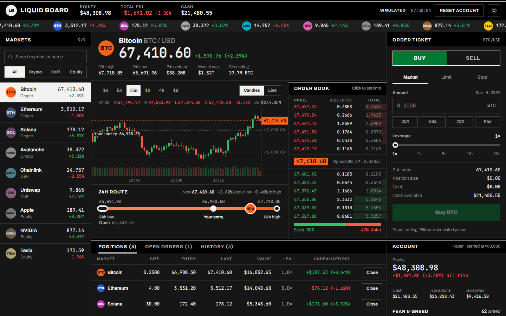
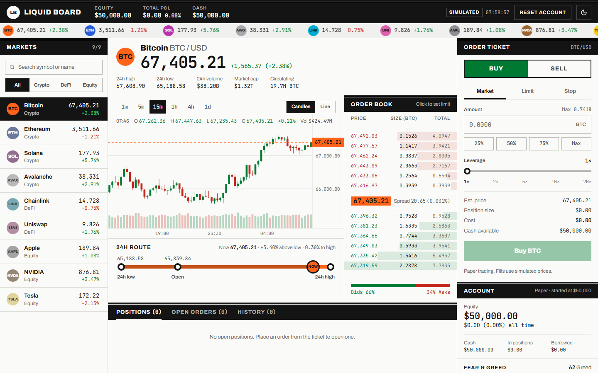

# LIQUID BOARD

**Paper trading terminal.** Trade crypto and equities against simulated live prices, with a $50,000 paper account and nothing at risk. Built with Next.js, TypeScript and Tailwind.

All market data is simulated in the browser. There is no backend, no wallet and no real exchange connection.

---

## Screenshots

### Dark


### Light


---

## Features

- **Nine markets:** BTC, ETH, SOL, AVAX, LINK, UNI, AAPL, NVDA, TSLA. Prices tick every 1.5s. Search the list and filter it by crypto, DeFi or equity.
- **Candlestick chart:** custom SVG with six timeframes (1m to 1d), each with its own history. Includes candle and line modes, volume, crosshair with OHLC readout, a live price tag, and your entry line.
- **24h route:** the day's range drawn as a transit line, with stations for the low, the open, your entry and the high. The live price moves along it as the train.
- **Order ticket:** market, limit and stop orders, % of balance presets, and 1–20× leverage.
  - Limit and stop orders rest until the price reaches them.
  - Leverage borrows against margin. A position is liquidated when its margin runs out.
- **Order book:** depth bars, spread, and bid/ask balance. Click a price to prefill a limit order.
- **Portfolio:** positions with unrealised P&L and one-click close, open orders with cancel, and trade history with realised P&L.
- **Account:** equity, cash, borrowed amount, fear & greed index, ETH gas. The account persists in localStorage and can be reset.
- **Keyboard:** `B` / `S` switch buy and sell, `1`–`9` select a market.
- **Themes:** dark and light, saved per browser and applied before first paint.
- **Responsive:** three columns on desktop, sidebar plus tabs on tablet, bottom tab bar on phones.

---

## Tech stack

| Layer | Tech |
|---|---|
| Framework | Next.js 14 (App Router) |
| Language | TypeScript |
| Styling | Tailwind CSS + CSS custom properties |
| Charts | Hand-built SVG |
| Type | Archivo, JetBrains Mono (via `next/font`) |
| Icons | lucide-react |
| Deployment | Vercel |

---

## Getting started

```bash
npm install
npm run dev
```

Open [http://localhost:3000](http://localhost:3000).

---

## Project structure

```
├── app/
│   ├── layout.tsx          # Fonts, metadata, no-flash theme script
│   ├── page.tsx            # Terminal: desktop / tablet / mobile layouts
│   └── globals.css         # Theme tokens, sign band, range input, motion
├── components/
│   ├── TopBar.tsx          # Header band: equity, P&L, cash, clock, theme
│   ├── TickerTape.tsx      # Scrolling price strip
│   ├── MarketList.tsx      # Search, type filter, market rows
│   ├── PairHeader.tsx      # Selected market price and 24h stats
│   ├── PriceChart.tsx      # SVG candlestick / line chart
│   ├── RouteStrip.tsx      # 24h route: range, open, entry, live price
│   ├── OrderTicket.tsx     # Buy / sell, order types, leverage
│   ├── OrderBook.tsx       # Depth, spread, click-to-limit
│   ├── PortfolioTables.tsx # Positions, open orders, history
│   ├── AccountPanel.tsx    # Equity breakdown, sentiment, gas
│   ├── MobileNav.tsx       # Bottom tab bar
│   ├── EventToasts.tsx     # Order fill / liquidation notices
│   ├── RouteBullet.tsx     # Coloured market bullet
│   ├── SignBand.tsx        # Black section band
│   └── ThemeToggle.tsx
├── hooks/
│   ├── usePrices.ts        # Price ticks, candle series, ranges, gas, sentiment
│   └── useAccount.ts       # Cash, positions, orders, fills, liquidation, storage
└── lib/
    ├── mockData.ts         # Assets, candle generation, order book
    ├── wallet.ts           # Types, P&L, trigger rules
    └── format.ts           # Price, currency and percentage formatting
```

---

## Design

The visual system borrows from transit signage:
- Black sign bands with a thin white rule name every work area.
- Each market has its own route-coloured bullet. Only the selected market shows its colour at full strength.
- Green and red appear only for up and down.

| Token | Dark | Light |
|---|---|---|
| Ground | `#161616` | `#fafaf8` |
| Sign band | `#000000` | `#141414` |
| Ink | `#f2f2f0` | `#141414` |
| Up | `#2fc46c` | `#007a33` |
| Down | `#ff5c50` | `#c4231a` |

---

## Deployment

Deployed on Vercel. Every push to `main` triggers a redeploy.

[](https://vercel.com/new/clone?repository-url=https://github.com/Omachilda-Dev1/Liquid-Board)
